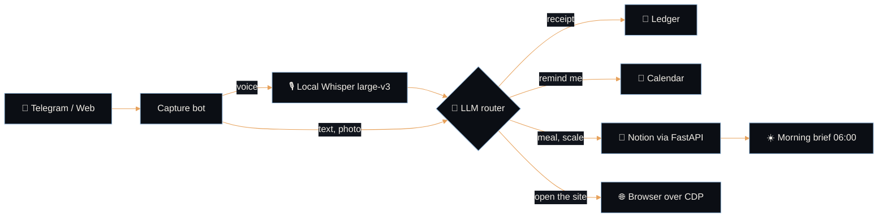

  

  
  
  
  

## Hi, I'm Oleksandr

**AI engineer and web developer in Valencia, Spain.** I put language models to work - LLM data extraction, RAG search, AI agents with MCP, voice assistants - and wrap them in fast, beautiful websites and Telegram bots your clients actually use. 5+ years of commercial Python, platforms with 1.5M+ records.

🇪🇸 Ingeniero de IA y desarrollador web en Valencia: páginas web, asistentes de IA, bots de Telegram y backends en Python. · 🇺🇦 AI-інженер і веб-розробник у Валенсії.

- 🛰️ **Now:** backend engineer in the core team of an OSINT platform - async collection, reliability, MCP tools for AI agents
- 🧠 **Building:** [Holy](https://oleksandr.62-238-84-212.sslip.io/#projects), my own AI assistant that runs my day on my own server
- 🌐 **For clients:** landing pages and business sites, AI assistants and chatbots, scrapers and data pipelines, Python APIs
- 📍 **Where:** Valencia, Spain · CET · remote for EU, UK, US or in person in Valencia
- 💬 **Ask me about:** RAG, LLM extraction, MCP agents, FastAPI, web scraping at scale, Telegram bots

## Selected work

Client code stays private. These are real systems, the problems and how I solved them. Full cases on <a href="https://oleksandr.62-238-84-212.sslip.io/#projects">the site</a>.

<table>
  <tr>
    <td width="50%"></td>
    <td width="50%"></td>
  </tr>
  <tr>
    <td width="50%"></td>
    <td width="50%"></td>
  </tr>
</table>

<b>🧠 How Holy works - click to open the architecture</b>

 

<b>🏢 Experience - five years of production code</b>

 

| When | Where | What |
|---|---|---|
| 2026 - now | **Social Links** · Backend engineer, core team | OSINT platform: API integrations, async collection, production reliability, MCP tooling for AI agents |
| 2024 - 2026 | **Niche Solutions** · Senior Python developer, parsing team lead | US real-estate data platform with API access to 1.5M+ records; LLM extraction with OpenAI and Llama, RAG with ChromaDB |
| 2022 - 2023 | **Codifire** · Python developer | AI content engine for SEO on Django REST and OpenAI; Telegram assistant for a medical clinic |
| 2021 - 2022 | **Bldup** · Python developer | Collectors for construction permits, mortgages, leases and deeds with Scrapy and PDF processing |

## Toolbox

    
  

<b>AI:</b> OpenAI · Claude · Llama · LangChain · RAG · ChromaDB · MCP · Whisper &nbsp;·&nbsp; <b>Data:</b> Scrapy · Playwright · CDP · gRPC · Celery · PostGIS

## Need a site or an AI assistant?

Write one message with your idea - I usually reply the same day.

Oleksandr Lukianets · AI engineer & web developer · Valencia, Spain · <a href="https://oleksandr.62-238-84-212.sslip.io/">oleksandr.62-238-84-212.sslip.io</a>

